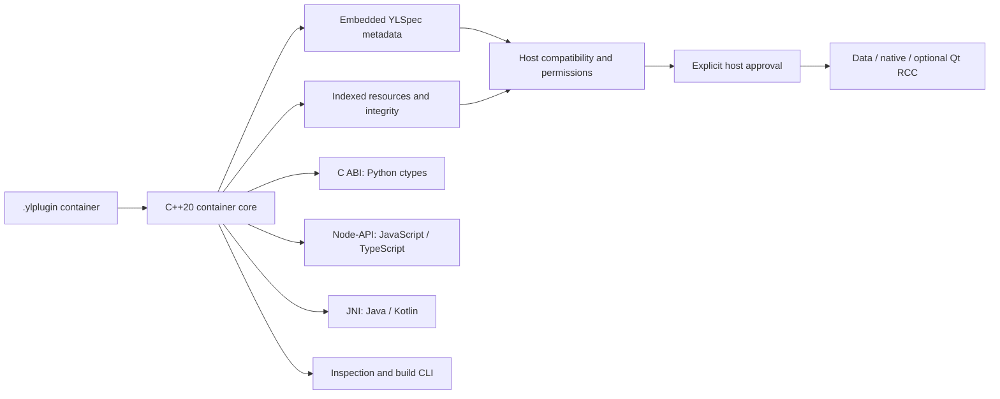

# YLPlugin

[](https://github.com/YoungLionOrganization/YLPlugin/releases/latest)
[](https://github.com/YoungLionOrganization/YLPlugin/actions/workflows/ci.yml)
[](https://github.com/YoungLionOrganization/YLPlugin/actions/workflows/libraries.yml)
[](https://pypi.org/project/ylplugin/)
[](https://pypi.org/project/ylplugin/#files)
[](https://www.npmjs.com/package/@younglionorganization/ylplugin)
[](https://central.sonatype.com/artifact/xyz.younglion/ylplugin)
[](docs/specification.md)
[](docs/api.md#c-abi)
[](docs/building.md)
[](docs/javascript-api.md)
[](docs/java-api.md)
[](docs/python-api.md)
[](docs/compatibility.md)
[](LICENSE)

**One plugin container. A shared native core. SDKs for your host language.**

[Documentation](docs/index.md) · [Examples](docs/examples.md) · [Downloads](https://github.com/YoungLionOrganization/YLPlugin/releases/latest) · [License](LICENSE)

A standalone plugin container and native SDK for applications that need to
inspect, validate, build and select components before executing them. A
`.ylplugin` has its own indexed binary format and embeds the existing YLSpec
metadata frame. It is not a renamed ZIP and does not require YLPkg or LeoMiniGames.

**Latest release: [v0.1.2](https://github.com/YoungLionOrganization/YLPlugin/releases/tag/v0.1.2), LGPLv3.**
Available on GitHub Releases, npm, PyPI and Maven Central. Published native SDKs
cover Linux x86_64/ARM64, macOS x86_64/ARM64 and Windows x86_64.
No stable ABI or production security audit is claimed during 0.x.

**In development: 0.1.3.** Work focuses on bounded-memory plaintext validation,
cancellation fixes, strict Node Unicode paths and incremental build versioning.
See the [changelog](CHANGELOG.md), [performance guide](docs/performance.md) and
[troubleshooting](docs/troubleshooting.md). Installation commands below use the
published 0.1.2 packages; 0.1.3 has not been released.

## Choose an SDK

| SDK | Implementation | Package / build |
|---|---|---|
| C / C++20 | Public C ABI and RAII handle | `YLPlugin::ylplugin`, [build instructions](docs/building.md) |
| JavaScript / TypeScript | Node-API over the same native core; ESM/CJS and declarations | [npm](https://www.npmjs.com/package/@younglionorganization/ylplugin), [API](docs/javascript-api.md) |
| Java 11+ | JNI, `AutoCloseable`, structured maps/lists | [Maven Central](https://central.sonatype.com/artifact/xyz.younglion/ylplugin), [API](docs/java-api.md) |
| Kotlin / JVM 11+ | Idiomatic `use` helpers over the Java/JNI library | [Maven Central](https://central.sonatype.com/artifact/xyz.younglion/ylplugin-kotlin), [API](docs/kotlin-api.md) |
| Python 3.11+ | Typed ctypes facade; native runtime in platform wheels | [PyPI](https://pypi.org/project/ylplugin/), [API](docs/python-api.md) |

The npm package and JVM native JAR collect only binaries built and tested by the
language CI matrix. Python wheels are tagged for their actual platform. Source
builds and unsupported platforms can supply an explicit native library path.
There is no second JS, Java or Python container parser and no runtime binary
download during SDK import. See [compatibility](docs/compatibility.md).

## Installation and quick starts

Python and Node.js packages are published separately from the source release:

```sh
python -m pip install ylplugin==0.1.2
npm install @younglionorganization/ylplugin@0.1.2
```

Python wheels include the native ctypes runtime. The npm package includes the
tested desktop Node prebuilds; TypeScript declarations ship in the same package.
Check the [platform requirements](docs/compatibility.md) before installation.
For JVM dependencies and Central availability, see the [JVM guide](jvm/README.md).

Run these examples from a checkout, using the included data container:

```python
import json
from ylplugin import Library

with Library().open("examples/artifacts/data.ylplugin") as plugin:
    plugin.validate()
    catalog = json.loads(plugin.read("catalog.json"))
    print(catalog["total"])  # 42
```

```javascript
import {Package} from '@younglionorganization/ylplugin';

const plugin = new Package('examples/artifacts/data.ylplugin');
try {
  plugin.validate();
  console.log(JSON.parse(plugin.read('catalog.json')).total); // 42
} finally {
  plugin.close();
}
```

Complete runnable examples: [Python](examples/data/read.py),
[JavaScript](examples/data/read.mjs), [Java](docs/java-api.md),
[Kotlin](docs/kotlin-api.md) and [C++](examples/read.cpp).

## Architecture



The host supplies its own runtime capabilities and permission grants. SDK loading,
package validation and plugin activation are separate operations. WASM execution
in the example is supplied explicitly by the host.

## What works

* Public YLSpec profile `xyz.younglion.plugin` / `1.0`, native validator and schema.
* Indexed store/Zstd resources, SHA256 integrity, bounded reads and verified slices.
* Multiple hosts, runtimes and entrypoints with deterministic preflight/fallback.
* Required/optional string, bitmask and byte permissions interpreted by the host.
* Ed25519 signatures, AES-256-GCM encryption and separate trust/license callbacks.
* POSIX transactional extraction, data/native adapters and optional memory RCC mounting.
* C/C++/JS/TS/Java/Kotlin/Python examples, conformance vectors and adversarial tests.

## Build and inspect

Requirements: CMake 3.26+, C++20/C11 compilers, YLSpec 0.1.2+, OpenSSL 3+, Zstd,
nlohmann-json 3.11+. Qt is optional and is not a dependency of the core or language SDKs.

```sh
cmake -S . -B build -G Ninja -DYLPLUGIN_YLSPEC_SOURCE=../YLSpec
cmake --build build --parallel 4
ctest --test-dir build --output-on-failure
build/ylplugin inspect examples/artifacts/data.ylplugin --json
build/ylplugin validate examples/artifacts/data.ylplugin
build/ylplugin check examples/artifacts/data.ylplugin --host examples/data/host.json
```

For native Node/JNI builds and platform packaging, follow [building](docs/building.md).
The existing `.rcc` conversion command remains available:

```sh
build/ylplugin convert legacy-game.rcc --manifest plugin.ylspec --output game.ylplugin
```

## More than RCC

| Example | Demonstrates |
|---|---|
| [Data catalog](examples/data/README.md) | JSON resource, multiple hosts, exact integer permissions; no Qt |
| [WebAssembly add](examples/wasm/README.md) | Verified WASM bytes and an explicit Node host runtime |
| [Native C plugin](examples/native/README.md) | Separate native ABI, external digest approval, prepare/start/stop/cleanup |
| [RCC/QML](examples/rcc/README.md) | Byte-preserving RCC conversion and optional memory-backed Qt mounting |
| [Encrypted/signed data](docs/examples.md#encrypted-and-signed-data) | Fresh keys, entitlement callback, signatures and tamper rejection |

`examples/artifacts` includes real RCC, data and WASM containers. Native examples
are generated for the actual build platform; private keys are never checked in.

## Trust boundaries

Metadata inspection and preflight execute no plugin code. `validate` checks
structure/profile/content; `verify` authenticates stored bytes separately. Neither
permission declarations nor signatures grant native/publisher authority. Hosts
must approve native code and independently validate/review RCC before Qt parses it.
Native execution is not sandboxed. The WASM example supplies its own host runtime;
there is no built-in WASM or Python execution adapter.

Secure Windows extraction, mobile device validation and an independent release
security audit remain open. SDK installation, SDK-native library loading and
plugin activation are separate operations. See [security](docs/security.md).

## Release verification

Version 0.1.2 was built from `81b1fa257ca7085f41180d2f2b08934a852c1940`.
[Core CI](https://github.com/YoungLionOrganization/YLPlugin/actions/runs/41709787677)
passed seven jobs, including desktop tests, sanitizers, fuzzing and packaging.
[Language SDK CI](https://github.com/YoungLionOrganization/YLPlugin/actions/runs/41709787678)
passed all five platform builds and aggregate packaging, including checks of the
actual license texts, source archives and package metadata.

Publication succeeded for [GitHub Releases](https://github.com/YoungLionOrganization/YLPlugin/actions/runs/41711388362),
[npm](https://github.com/YoungLionOrganization/YLPlugin/actions/runs/41711646655),
[PyPI](https://github.com/YoungLionOrganization/YLPlugin/actions/runs/41711655711)
and [Maven Central](https://github.com/YoungLionOrganization/YLPlugin/actions/runs/41711661036).
See the [test report](docs/test-report.md) for executed checks and platform limits.

## Documentation

Start with [the documentation guide](docs/index.md), [examples](docs/examples.md),
[CLI reference](docs/cli.md) or [the normative format](docs/specification.md).
[Publishing](docs/publishing.md) explains organization secrets, immutable artifacts,
registry scopes and the manual npm/PyPI/Maven workflows. The availability check
never prints secret values and does not publish packages.

YLPlugin is licensed under **LGPL-3.0-only**: [LICENSE](LICENSE),
[incorporated GPLv3 terms](COPYING) and [licensing guide](LICENSING.md).
Packages include the license texts and corresponding project source; see
[SOURCES.md](SOURCES.md). Third-party dependency terms remain separate.

Maintained by [Cavanshirpro](https://github.com/Cavanshirpro) under
[YoungLionOrganization](https://github.com/YoungLionOrganization).

For bug reports and development verification, see [contributing](CONTRIBUTING.md).
