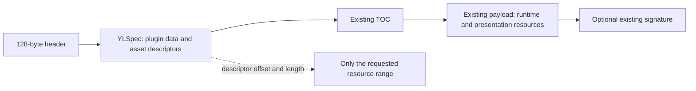

# Proposal: discover and selectively read presentation assets

Status: **architecture under implementation**. Catalog declarations, an authoring
schema and a native C++ validator are implemented in 0.1.4 development; see the
[catalog contract](../presentation-catalog.md). Automatic detection, locator
generation, discovery handles and selective asset I/O remain planned in the
[roadmap](../../ROADMAP.md). Existing normative byte/profile contracts remain the
[container 1.0 specification](../specification.md) and [profile 1.0](../profile.md).

## Decision and rationale

Keep presentation files as ordinary indexed resources in the existing payload.
Add a versioned optional YLSpec extension containing **descriptors**, including
their final absolute offsets, lengths and SHA-256 hashes. A new discovery reader
can then read the header, YLSpec frame and exactly one selected asset without
opening a `Package`, scanning the TOC or reading other resources.

Do not put document bodies, icon bytes, base64, data URLs or a second archive
inside metadata. Do not introduce a new container header, change reserved bytes
or add unknown fields to `data`: profile 1.0 rejects unknown `data` fields, while
YLSpec already supports namespaced optional extensions.

This works with the existing wire layout:



The ordinary TOC still contains each resource and supports normal validation,
extraction and runtime access. The presentation catalog duplicates only the small
amount of location/integrity information needed to avoid reading that TOC.

## User-visible behavior

1. Packaging detects or accepts an explicit icon, README, license and other guides.
2. Metadata describes which files were packaged, their roles, formats and locations.
3. A host discovers descriptors without loading any of those files.
4. The host requests an icon or document by ID when it needs that content.
5. The native reader fetches that one range, verifies its declared hash and returns bytes.

A descriptor means **declared present**, not already content-verified. A missing
catalog in an old package means presentation was not declared; it does not prove
that no README exists somewhere in its payload. No fallback scans are implicit.

A file handle is still necessary for local reads. “Without opening the whole
plugin” means no full-package parse, index scan or whole-file content read, not
an impossible promise of reading bytes without opening a file handle.

## Catalog v1 draft

Namespace: `xyz.younglion.ylplugin.presentation`. Extension version: `1.0`.
Container, plugin profile and embedded YLSpec frame remain at 1.0, 1.0 and 0.1.
The namespace is an identifier, not a server lookup or ownership certificate.

This is an **illustrative metadata fragment**, not author input or a complete
conformance vector. Offset, length and hash values are generated from final staged
resources and must be recomputed for the actual package.

```toml
[extensions."xyz.younglion.ylplugin.presentation"]
version = "1.0"

[extensions."xyz.younglion.ylplugin.presentation".primary]
readme = "readme"

[[extensions."xyz.younglion.ylplugin.presentation".assets]]
id = "readme"
role = "readme"
resource = "docs/README.md"
media_type = "text/markdown"
format = "markdown"
encoding = "utf-8"
offset = 2936
length = 49
sha256 = "1a1ee81fcf27adbb8522191b004daa01f01aaaae2fb046a8d0f90b2f6c4ddc68"
```

The example hash is for the 49-byte README in the feasibility experiment below.
The package writer owns all physical locations and hashes, not the author recipe.

| Field | Proposed meaning and validation |
|---|---|
| `version` | Exact supported catalog version; unknown versions remain inert metadata |
| `primary` | Optional role-to-asset-ID table; each selection must exist and have that role |
| `assets` | Bounded array of descriptors, in deterministic `(role, id)` order |
| `id` | Unique portable identifier, 1..255 ASCII letters/digits/`._-` |
| `role` | v1: `icon`, `readme`, `license`, `contributing`, `security`, `code_of_conduct`, `changelog`, `notice` |
| `resource` | Canonical container path, following its portable ASCII and 1024-byte limit |
| `media_type`, `format` | Validated supported pair, for example `text/markdown` + `markdown` |
| `encoding` | Required `utf-8` for v1 text documents; absent for images |
| `offset` | Absolute package byte position, divisible by 8; nonnegative TOML signed-64 integer |
| `length` | Exact stored/plaintext byte length; nonnegative signed-64 integer |
| `sha256` | SHA-256 of the complete returned bytes, 64 lowercase hex characters |

For a supported catalog version, reject unknown fields, invalid role/format
pairs and missing required fields instead of guessing their meaning. Automatic
mode generates primary selections for the chosen role files; explicit IDs remain
the asset-read interface when a role has several files.

There is no redundant `exists = true`: a descriptor declares presence. Multiple
license files can have different IDs with the same role; `primary.license` selects
the first view without discarding companion terms such as COPYING or NOTICE.
A filename is not evidence of an SPDX expression or legal compatibility.

V1 presentation resources are **store + plaintext**, with no runtime variant.
The named TOC resource must have the same offset, stored/plaintext size, hash and
media type. An asset requiring decryption, decompression or extraction is not a
v1 direct-preview asset. Do not silently reinterpret those flags as plaintext.
The catalog contains no source-machine absolute paths or external content URLs.

Each descriptor must fit inside the header's declared payload interval, not the
header, metadata, TOC or signature. Validate subtraction bounds before addition.
Resource aliases must agree on their physical range, hash, format and media type;
partial overlaps or conflicting declarations are invalid. Exact reuse of one
resource for explicitly declared aliases is permitted. Empty text files have
length zero and the SHA-256 of empty bytes; they are distinct from absent files.

## Packaging and conventional-file discovery

The CLI should enable conventional discovery by default for new builds, with
explicit overrides and an off switch. The native builder accepts an explicit
policy/root and never guesses which parent directory to scan for a library call.

Proposed flags below are **not available in 0.1.3**:

```sh
ylplugin create --manifest plugin.ylspec --root resources \
  --project-root . --presentation auto --output plugin.ylplugin
# Explicit source/package-path mappings and role exclusions:
ylplugin create --manifest plugin.ylspec --plan resources.json \
  --project-root . --presentation-config presentation.json --output plugin.ylplugin
# Deliberately build without a presentation catalog:
ylplugin create --manifest plugin.ylspec --root resources \
  --presentation off --output plugin.ylplugin
```

`--root` continues to mean runtime-resource input. `--project-root` is the bounded
presentation search root; absent an override, it is the manifest's parent. Do not
walk ancestors, dependency directories, home directories or the complete project
tree. Resolve explicitly configured source paths inside that root, reject
symlinks/reparse escapes and include only regular files.

Search a documented, bounded candidate list. Proposed document directory
precedence is project root, `.github/`, then `docs/`; this is inspired by repository
conventions and is **not a promise of matching GitHub's exact precedence**.
Within a directory prefer Markdown, then `.txt`, then the extensionless name.
Case-insensitive matches with case-aliased names are an error for portability.

| Role | Conventional candidates |
|---|---|
| `readme` | `README.md`, `README.markdown`, `README.txt`, `README` |
| `license` | `LICENSE`, `LICENCE`, `COPYING`, with `.md`/`.txt` variants; retain distinct companions |
| `contributing` | `CONTRIBUTING.md`, `.txt`, or extensionless |
| `security` | `SECURITY.md`, `.txt`, or extensionless |
| `code_of_conduct` | `CODE_OF_CONDUCT.md`, `.txt`, or extensionless |
| `changelog` | `CHANGELOG.md`, `.txt`, or extensionless |
| `notice` | `NOTICE`, `NOTICE.md`, `NOTICE.txt` |
| `icon` | Explicit bounded `icon`/`logo` candidates in root, `assets/`, `icons/`, `.github/`; v1 PNG, WebP, JPEG |

For icons, use directory order as listed, `icon` before `logo`, then PNG, WebP,
JPEG format order. The final filename list and candidate-count budget must be
frozen with P1 vectors. Expose the chosen file and skipped alternatives in the
build report; never use filesystem traversal order as precedence. Explicit
mappings take priority, and a missing explicit source is an error rather than a
silent fallback. A missing conventional file is a normal absent role.

Default package paths preserve the selected project-relative path. An explicit
mapping can provide another portable package path, including when a source
filename is Unicode. Reuse an existing input resource only when bytes and the
public/store policy match. Conflicting same-path content or codecs require a
clear mapping/policy error, not an implicit overwrite or plaintext leak.

The build recipe contains source paths and role preferences; the emitted catalog
contains generated package descriptors. Callers cannot supply trusted offsets or
hashes. Do not infer executable entrypoints, license expressions or host grants
from conventional filenames.

## Writer pipeline and the offset/metadata dependency

The [current writer](../../src/container/container.cpp) emits metadata before it
reads/compresses individual inputs. Direct asset locations require an additional
planning phase; repeatedly rewriting partially published packages is not the design.

1. Resolve normal resource inputs and detected/explicit presentation inputs.
2. Snapshot bounded source bytes once into private staging, compute hashes and
   prepare compressed runtime records. Never hash one source version and emit another.
3. Keep preview assets public/store. Know every stored size, path, media, alignment
   and encoded TOC record length before computing final addresses.
4. Create the managed catalog with all generated offsets initialized to integer zero.
5. Solve metadata size and final absolute offsets together, as described below.
6. Serialize final YLSpec once more and assert the measured frame length and every
   planned address match the layout. Reject stale, inconsistent or overflowing output.
7. Emit header, metadata, TOC, padding and staged resources in existing canonical
   TOC/path order. Apply encryption to runtime records only after final addresses
   and GCM AAD are known; ciphertext length is known before that operation.
8. Validate the staged package **and** catalog-to-TOC consistency, then publish
   atomically without replacement. Clean staging on failure or cancellation.

Temporary-file encryption/nonces, secret handling, byte budgets and the existing
no-replacement behavior remain explicit. A compressed/encrypted resource must
not be recompressed or re-encrypted on each planning round. Staging must also
have a disk budget and cancellation checks; bounded buffers alone do not bound disk use.

### Why integer offsets can converge without a format change

Metadata grows when an offset needs another decimal digit. With staged sizes and
resource order fixed, an increase in metadata length cannot decrease any
**absolute** resource offset: each step is addition and monotone alignment.
Starting every locator at zero therefore makes offset digit widths nondecreasing.
A catalog integer is at most `INT64_MAX`, so its width is at most 19 digits.
For `N` assets there are at most `18*N` digit-width increases after the zero seed.
Once the serialized metadata length stops changing, the computed physical layout
is stable. Confirm the final values, not merely an iteration counter.

Mixed 8..4096-byte resource alignments do not break this argument for absolute
positions. Payload-relative positions can decrease when the base shifts across
an alignment boundary, so do not substitute relative positions in this proof.
Do not hash metadata into its own catalog, or include mutable signatures/source
paths/timestamps among the fields driving the calculation.

A practical planner can serialize the zero-offset catalog once, then calculate
size changes from decimal widths. This is valid only while those integer values
are the sole variable serialization fields; assert that condition against the
final native YLSpec output. Avoid serializing a near-limit document on every round.
Enforce a planning/work budget and fail with a resource-limit error if exhausted;
never publish the last unstable guess. Core offsets remain uint64, but catalog
v1 deliberately rejects values above the YLSpec signed-64 range.

## Reader contracts and proposed API surface

Use the native YLSpec parser and one new native catalog validator. Bindings must
not add independent Python/JS/JVM container decoders. `read_metadata` stays as-is.

Proposed names, subject to API review:

| Layer | Proposed operation |
|---|---|
| C++ | `Discovery(path_or_reader, options)`, `assets()`, `read_asset(id)` |
| C ABI | Versioned discovery options; open/path-or-reader, descriptor listing, asset read, close; owned `ylp_buffer` outputs |
| Python | `Library.discover(...)` as a context manager; `.assets`, `.read_asset(id)` returns bytes |
| JS/TS | `Discovery`, `assets()`, `readAsset(id)` returning Buffer; ESM/CJS declarations |
| Java/Kotlin | AutoCloseable discovery handle and byte-array reads; Kotlin `use` helper |
| CLI | `ylplugin assets FILE --json`; `ylplugin asset FILE --id readme --output NEW_FILE` |

The CLI creates new output files without replacement and never renders or executes
content. Asset reads select an ID from the validated native catalog, not a caller-
supplied raw byte offset. Add independent versioned presentation options; do not
append fields to the existing exact-size C ABI limits structure in place.

Opening discovery requests the fixed header and exact YLSpec frame only. It
checks header/layout arithmetic and the catalog without reading any TOC bytes.
It retains a reader/snapshot, not a full Package. Listing assets adds no reads.
Requesting an asset reads only that declared range, checks cancellation and hashes
the complete selected bytes before returning them. No speculative buffering,
TOC fallback, adjacent-file prefetch, decompression, decryption or extraction.

For metadata frame length `M` and asset length `L`, a fresh one-shot operation
requests **`128 + M + L` bytes**; header and document frame are counted once.
A retained discovery handle adds only `L` for an uncached subsequent asset.
An unknown ID or unsupported catalog version fails before any asset-body read.
Header/frame syntax reads needed to discover the error are still allowed.

Host caching is explicit and bounded, keyed to the source snapshot and metadata
identity, not merely plugin ID/version. No API loads all asset bodies by default.
A file handle's persistence is not a cryptographic guarantee of immutability.

### Proposed independent limits

Initial values for implementation review, not changes to current `Limits`:

| Budget | Proposed default |
|---|---:|
| Catalog entries | 64 |
| Catalog descriptor contribution | 256 KiB within the existing metadata limit |
| Individual UTF-8 document | 1 MiB |
| Individual icon | 2 MiB |
| Aggregate declared presentation bytes | 16 MiB |

Check declarations before allocation and actual bytes during reads. Apply the
metadata/parser budgets independently. Return only a bounded complete verified
buffer in v1; streaming unverified chunks would change the integrity contract.
Text validation and lightweight image format checks belong to packing/asset
validation; full image decoding and pixel/dimension limits belong to the host.

## Repacking, compatibility and full validation

- Existing 1.0 packages have no catalog: metadata discovery and normal resources
  continue working, while selective presentation discovery reports not declared.
- Old 0.1.3 readers can preserve/ignore this optional extension; it does not grant
  new runtime or permission semantics. Do not add `_ylspec.requires` by default.
- Old writers **cannot safely regenerate physical locators**. Repacking with one
  can leave a stale catalog even if ordinary package validation passes. New fast
  reads must fail bounds/hash checks instead of silently returning unchecked data
  or scanning the whole container. Document supported writer versions explicitly.
- New create/repack/encrypt paths regenerate managed descriptors from staged
  resources. `--presentation off` explicitly removes the managed catalog.
- Encrypting runtime content must preserve public presentation resources; reject
  attempts to label encrypted bytes as direct-preview documents. Signing currently
  appends a block without shifting resources, so it does not require new offsets.
- Unknown catalog versions remain inert for metadata/core execution; asset APIs
  report unsupported. Malformed supported catalogs are rejected by the asset API.
- Add an explicit full catalog validator that cross-checks declarations against
  actual TOC entries, codecs, variants, paths, lengths, hashes and media types.
  Writers must use it; a fast read does not claim to have performed that check.

Full runtime validation and preflight remain separate. A presentation extension
must not turn a preview failure into permission approval or automatic activation.

## Trust, rendering and remote ranges

The hash proves selected bytes match a descriptor. An attacker can replace both
metadata and bytes: this does **not** authenticate publisher identity or make
Markdown/image data safe to render. Return checksum status separately from source
trust; use `UNVERIFIED` unless host policy supplies independent trust evidence.

The existing Ed25519 algorithm signs a SHA512 commitment to the entire package
prefix. Checking it still requires reading that prefix, including runtime payloads.
Do not claim a signed/authenticated preview with zero payload scan under this
algorithm. A future authenticated discovery commitment needs a separate design
or explicit host-pinned catalog from a trusted registry.

A host front page can discover once, read an icon when displayed, and read the
README/license/security guide only when its panel opens. Native code returns
bytes, MIME/format and encoding information; it does not embed a browser,
Markdown renderer, image codec or HTTP client. Host examples must sanitize markup,
block executable HTML, restrict URI schemes and avoid implicit remote image fetches.
SVG and richer document formats need an explicit later policy, not automatic v1 rendering.

For HTTP ranges, the host callback must require correct `206`/`Content-Range`,
exact length and a stable source (for example strong ETag + `If-Match`). Inspect
headers before accepting a response body; reject a `200` whole-object response
without downloading it as a fallback. Source changes require rediscovery. ETags
provide snapshot consistency, not publisher authentication.

## Alternatives considered

| Alternative | Tradeoff and decision |
|---|---|
| Inline Markdown/base64 icons | Violates metadata-only content separation and eagerly loads files; reject |
| Path-only references | Requires a TOC lookup; cannot meet a zero-TOC fast read by itself |
| Pointer to one TOC record | Avoids a full scan, but adds a TOC read; possible fallback design, not the selected contract |
| New 1.1 header and dedicated preview section | Avoids duplicated locators but breaks old readers and adds a new section; unnecessary for v1 |
| Absolute locators in optional metadata | Existing layout works; requires bounded writer planning and stale-catalog checks; selected |

## Feasibility evidence and implementation gates

An [architectural experiment](presentation-layout-experiment.json) used the
**existing 0.1.3 native writer and reader**
with a catalog in this namespace, three public assets and an 8192-byte runtime
resource aligned to 4096 bytes. No native feature was added for the experiment.
Three planning writes reached stable metadata length/addresses:

| Round | YLSpec frame bytes | Icon offset | README offset | Security offset |
|---|---:|---:|---:|---:|
| Zero-offset seed | 1814 | 2744 | 2928 | 12288 |
| Generated locators | 1824 | 2752 | 2936 | 12288 |
| Stable confirmation | 1824 | 2752 | 2936 | 12288 |

Each package passed existing native validation. A **host-side simulated asset
read**, following a native `read_metadata_reader` call, requested only ranges
`[0,128)`, `[128,160)`, `[160,1952)` and `[2936,2985)`. Its 49-byte README hash
matched the catalog. Total requested bytes were **2001 of 12340**; no TOC, icon,
security file or runtime bytes were requested. This establishes feasibility for
that fixture, not a released discovery API or exhaustive conformance result.

Before implementation can ship, add native tests for a virtual 5 GiB source,
malformed/out-of-payload locators, metadata limits, empty files, full hash checks,
overlap/duplicate declarations, deterministic precedence, mixed alignments and
decimal digit boundaries. Verify old-writer stale catalogs, public previews in
encrypted packages, signature status, cancellation and source changes. Repeat the
installed-artifact matrix for all SDKs. See the [delivery gates](../../ROADMAP.md).
