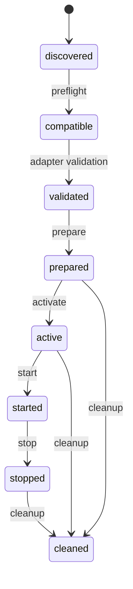

# Runtime adapters and lifecycle

The Qt-free C++ SDK separates discovery, compatibility, validation, preparation,
activation, start, stop, cleanup and error propagation. `Adapter::id()/version()`
are independently versioned. Hosts register available IDs/versions for preflight,
then construct the selected adapter and a `Session`. The session checks the
adapter's actual version, rejects a mismatched selected runtime and enforces:

Preparation failures clean up and mark failed. Activation/start failures also
clean up. Destruction stops and cleans up; stop/cleanup are idempotent and must
not throw. A stopped session is not restartable; create a new session. Adapters
and sessions are confined to their host thread unless the host synchronizes them.
Package reads are independently thread-safe.

| Runtime | Implemented behavior |
|---|---|
| `data` 1.0 | Verify/decode entrypoint resource into memory; no executable code |
| `qt.rcc` 1.0 | Optional QtCore library, memory-backed RCC registration; host owns QML engine |
| `native` 1.0 | Extract one library into a new private cache; explicit host digest approval; load only on activation |
| WASM | No adapter; preflight NEEDS_RUNTIME unless host supplies one |
| Python execution | No adapter; the Python SDK reads/writes containers only |
| Generic QML/engine/service runtimes | Host-supplied adapters; not claimed implemented |

The memory `data` and RCC adapters reject extract-required resources. A host may
provide a filesystem data adapter. Native rejects direct-required. Preflight
reports the resource/runtime strategy and its reason; it cannot guarantee the
behavior of a separately supplied runtime or platform. The SDK never silently
extracts direct-required resources.

Native execution can run constructors at `dlopen`/LoadLibrary time. It is NOT a
sandbox. `NativeApproval` MUST compare the supplied digest with a host-controlled
reviewed allowlist and perform publisher/API/ABI checks. Do not return true merely
because the digest equals the plugin's own TOC digest. The host explicitly opts
into native execution and extraction. No native loading occurs in preflight,
validation or preparation. `include/ylplugin/native.h` describes the new small C
runtime ABI (`ylp_native_query`, ABI 1, start/stop/destroy). It is separate from
LeoMiniGames' Qt `IGamePlugin` ABI. The initial adapter extracts one library, not
its dependency graph; dependencies must be host-installed/reviewed. OS library
resolution must not be mistaken for plugin dependency installation.

RCC registration uses the exact Qt memory overload. The adapter retains its
buffer while mounted. Hosts destroy QML objects, engines, background callbacks,
QFiles and QResources before session cleanup. When Qt reports references still
exist on unregister, the adapter deliberately retains the bytes until process
exit. There is no force-free or reference-count guessing. This avoids use-after-free
at the cost of retained memory; hosts should use correct teardown ordering.
Repeated busy teardown is not a bounded cache and must be controlled by the host.
The callback must approve reviewed/independently validated RCC bytes: Qt's API
has no length argument, and YLPlugin does not claim to harden Qt's internal RCC
parser. A signature alone does not satisfy this trust requirement.

The RCC adapter mounts resources only; it does not instantiate QQmlEngine or
provide QML host services. This preserves host isolation and existing game API
negotiation. A plugin's declared permission metadata never becomes actual QML,
filesystem or native authority automatically.

Mobile: destroy engines before memory release; cancel preparation during
background transitions when appropriate; retain active buffers while consumers
exist; pause/stop gameplay using host lifecycle services. Memory pressure is a
host decision, not permission to free mounted bytes. External native activation
is disabled for Android/iOS. Store and application policies remain a host release
responsibility; this SDK does not claim App Store/Play Store approval.
