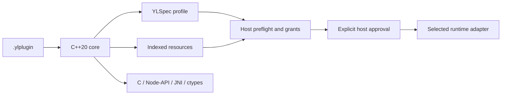

# YLPlugin Wiki

**0.1.3 additions:** [direct metadata-only reads](Metadata-Only-Reads.md)
request only the 128-byte header and YLSpec frame. TOC, payload and signature
regions are not read. Discovery returns unverified metadata; validation and host
preflight remain separate. Python/npm now bundle the native CLI alongside the
core; Java/Kotlin supply a Java CLI entry point. See
[core/CLI installation and PATH behavior](../installation-cli.md).
These additions are available from 0.1.3.

YLPlugin is a standalone plugin container and a native SDK for inspecting,
building, validating and selecting components before a host activates them.
The container embeds YLSpec metadata and indexes its own resources. The core is
C++20 with a public C ABI, Node-API JavaScript/TypeScript bindings, JNI Java/Kotlin
bindings and a Python ctypes facade.

**SDK baseline: 0.1.3.** Container/profile
1.0, C ABI version 1, runtime ABI and the host application's API are independently
versioned. Original project material is LGPL-3.0-only.

## Start here

| Your goal | Read |
|---|---|
| Read a real package in a few minutes | [Getting Started](Getting-Started.md) |
| Select packages/toolchains for your platform | [Installation and Builds](Installation-and-Builds.md) |
| Understand the byte layout and metadata | [Container and Profile](Container-and-Profile.md) |
| Author a portable data component | [Authoring Plugins](Authoring-Plugins.md) |
| Build a host integration | [Host Integration](Host-Integration.md) |
| Understand compatibility and grants | [Permissions and Preflight](Permissions-and-Preflight.md) |
| Use a language SDK | [Python](Python-SDK.md), [JS/TS](JavaScript-and-TypeScript.md), [Java/Kotlin](Java-and-Kotlin.md) |
| Authenticate or encrypt a package | [Signing and Encryption](Signing-and-Encryption.md) |
| Run a command-line workflow | [CLI Cookbook](CLI-Cookbook.md) |
| Integrate runtime lifecycle or Qt resources | [Runtime Adapters](Runtime-Adapters.md), [Qt RCC and Migration](Qt-RCC-and-Migration.md) |
| Investigate limits or performance | [Performance and Limits](Performance-and-Limits.md) |
| Diagnose a failure | [Troubleshooting](Troubleshooting.md), [FAQ](FAQ.md) |
| Maintain the project | [Testing and Contributing](Testing-and-Contributing.md), [Publishing](Publishing-and-Maintenance.md) |
| Redistribute or rebuild the library | [Licensing and Sources](Licensing-and-Sources.md) |
| Support development or join maintenance | [Support and Community](Support-and-Community.md) |

## Architecture and authority

Opening, inspecting or validating a package does not execute plugin code. Hash
validation, signature trust, content decryption and permission grants answer
different questions. Native execution is not sandboxed. The host owns runtime
registration, API versions, budgets and decisions about reviewed publishers/code.

## What is available

The released language SDKs cover Linux x86_64/ARM64, macOS x86_64/ARM64 and
Windows x86_64. Python platform wheels include a native runtime; npm carries Node
prebuilds; Maven supplies Java, Kotlin and a native runtime JAR. Linux wheels
require glibc 2.39. Node 20+, Python 3.11+ and JVM 11+ are the language baselines.

The core supports indexed store/Zstd records, SHA256, Ed25519, AES-256-GCM,
host-scoped permissions, preflight and controlled POSIX extraction. Runtime
adapters implement data, approved native libraries and optional Qt RCC mounting.
WASM execution in the example is supplied explicitly by its Node host; there is
no automatic Python execution adapter, Android AAR, installer or dependency solver.

## 0.1.4 development and planned plugin front pages

The [catalog contract](../presentation-catalog.md) now has an experimental C++
declaration validator and schema on main. The source SDK is 0.1.4; installation
examples stay on release 0.1.3. Native/facade versions must match.

The [roadmap](Roadmap.md) describes automatic icon/README/license/security file
selection, descriptor-only metadata and explicit reads of individual assets.
The [architecture proposal](../design/presentation-assets.md) uses the existing
container layout and explains stable locator generation. These are planned
features, distinct from the implemented metadata-only API.

## Evidence and document status

The 0.1.4 catalog foundation at `bb21a5fc6fe8df11d4467e4d0dfe815e9cc71bb8`
passed all thirteen [core](https://github.com/YoungLionOrganization/YLPlugin/actions/runs/42976535690)
and [SDK/package](https://github.com/YoungLionOrganization/YLPlugin/actions/runs/42976535599) jobs.
It includes 41 native declaration checks and 34 structural schema vectors.
These are development artifacts, not a 0.1.4 release.

Metadata discovery and bundled CLI implementation:
`e1b2ed7a8638e825cbdb9989c342276703405f36`. Its
[five-platform SDK and packaging CI](https://github.com/YoungLionOrganization/YLPlugin/actions/runs/42125664789)
passed all six jobs, including fresh wheel installs and actual npm/JVM package
checks. The [core workflow](https://github.com/YoungLionOrganization/YLPlugin/actions/runs/42125664950)
passed all seven jobs: four desktop platforms, sanitizers, fuzz and source-asset
packaging. Together the workflows passed all thirteen jobs.

Earlier performance and Unicode work at
`cca0c717309857d2223421e547b29bd4a077527e` passed all thirteen jobs across
[core CI](https://github.com/YoungLionOrganization/YLPlugin/actions/runs/41889748794)
and [SDK CI](https://github.com/YoungLionOrganization/YLPlugin/actions/runs/41889749475).
GitHub, PyPI and Maven 0.1.3 publication succeeded; npm is awaiting token permissions.
See the [publication record](../publishing.md#version-013-publication).

The Wiki is an explanatory guide. [The specification](../specification.md) and
[profile](../profile.md) define the normative byte/metadata contract. Versioned
Wiki sources live in `docs/wiki`; the main README links both guides and release evidence.
