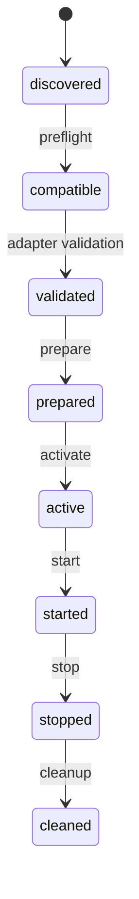

# Runtime Adapters

An SDK binding is not an execution runtime. Node-API/JNI/ctypes expose host
operations; the host separately registers compatible runtime IDs and constructs
an adapter that owns activation behavior.

## Session state

Failures during prepare/activate/start clean up and mark failure. Destruction
stops/cleans up. Stop and cleanup are idempotent and must not throw. A stopped
session is not restarted; create a new approved session. Session and adapter
operations are confined to the host thread unless synchronized by the host.

## Implemented adapters

| Adapter | Behavior |
|---|---|
| data 1.0 | Validates/decodes the selected resource into memory; no code execution |
| qt.rcc 1.0 | Optional memory-backed RCC registration; the host owns engines/QML objects |
| native 1.0 | Approved library in a new private cache, loaded only at activation |

WASM and Python execution adapters are not built in. The WASM example explicitly
uses a Node WebAssembly host after preflight and verified resource reading.
Generic engine/service/runtime integration is a host extension, not an
implemented automatic plugin mechanism.

## Native adapter policy

The host opts into native execution and extraction. Its NativeApproval callback
must compare the resource digest with an independently reviewed allowlist and
apply publisher/API/ABI checks. Comparing the TOC digest with the same package's
claimed digest is not an approval policy.

Preparation extracts; activation loads. Native library constructors can execute
at load time, so native activation is not a sandbox. The native C ABI uses
`ylp_native_query`, ABI 1 and start/stop/destroy hooks. It is separate from
LeoMiniGames' Qt IGamePlugin ABI. Dependencies must be host-installed/reviewed;
the adapter does not resolve a plugin dependency graph.

## Strategy and platform limits

Direct-required resources cannot be silently extracted. The memory data/RCC
adapters reject extract-required resources; native requires extraction. Preflight
explains the chosen strategy but cannot guarantee an independently supplied
runtime's behavior.

Secure Windows extraction is not implemented, so external native plugin
activation remains unsupported there even though Windows SDK operations pass CI.
External native activation is disabled for Android/iOS. No store/device approval
or mobile lifecycle validation is claimed.

Read [Qt RCC and Migration](Qt-RCC-and-Migration.md),
[host integration](Host-Integration.md) and the [runtime reference](../runtime.md).
